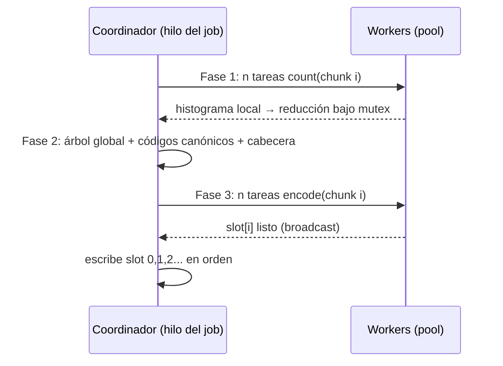

# Módulo de compresión Huffman concurrente y ThreadPool

Archivos: [threadpool.c](threadpool.c) / [threadpool.h](threadpool.h),
[huffman_mt.c](huffman_mt.c) / [huffman_mt.h](huffman_mt.h),
pruebas en [test_huffman.c](test_huffman.c) (`make test`).

## 1. ThreadPool

Pool de tamaño fijo con una cola FIFO de tareas.

```c
ThreadPool *tp_create(int n);
int  tp_submit(ThreadPool*, void (*fn)(void*), void *arg);
void tp_wait(ThreadPool*);      // barrera: cola vacía y 0 tareas en ejecución
void tp_destroy(ThreadPool*);   // drena, detiene y une los hilos
```

- Un `mutex` protege la cola (lista enlazada con `head/tail`), el contador `active` y el flag `shutdown`.
- `has_work` (condvar): los workers duermen hasta que hay una tarea o se apaga el pool.
- `idle` (condvar): `tp_wait` duerme hasta que `head == NULL && active == 0`; el último worker en terminar emite `broadcast`.
- Orden **FIFO**: las tareas empiezan en el orden en que se encolan. Esta propiedad es la que hace correcto el control de ventana de la sección 3.
- Los workers ejecutan la tarea **fuera del lock**.
- Apagado: `shutdown = 1` + `broadcast`; un worker solo sale cuando la cola está vacía, así que no se pierden tareas.

## 2. Formato `.huf`

Enteros en little-endian.

```
Cabecera (277 bytes)
  "DHUF" | versión u8 | chunk_size u32 | tamaño_original u64 | n_chunks u32
  | longitudes de código de los 256 símbolos (u8 c/u, 0 = ausente)
n_chunks registros, en orden:
  tam_original_chunk u32 | bytes_comprimidos u32 | CRC32 del chunk original u32 | bits
```

Los códigos son **canónicos**: se reconstruyen solo a partir de las longitudes
(ordenadas por longitud y luego por símbolo), por lo que no hace falta guardar
el árbol. La longitud máxima es 15 bits: si el árbol resulta más profundo se
reducen a la mitad las frecuencias (mínimo 1) y se reconstruye. El resultado
es determinista: la salida es byte a byte la misma con 1 u 8 hilos.
El archivo se divide en bloques de 256 KiB.

## 3. Compresión



1. **Conteo**: cada tarea hace `pread` de su bloque (los workers comparten el descriptor sin tocar el offset), acumula un histograma **local** de 256 contadores sin sincronización, y al final lo suma al global bajo un único mutex (reducción: un lock por bloque, no por byte).
2. **Árbol**: `tp_wait` actúa de barrera; un solo hilo construye el árbol (256 símbolos como máximo) y los códigos.
3. **Codificación**: cada tarea lee su bloque, lo codifica con acumulador de bits y calcula su CRC32; deja el resultado en `slots[i]`.
4. **Escritura ordenada**: el hilo coordinador espera (condvar `ready_cv`) el slot `next`, lo escribe, lo libera, y avanza. Los slots pueden terminar desordenados, pero se escriben siempre en secuencia, sin espera activa.
5. **Ventana acotada** (`space_cv`): un worker no publica el bloque `i` hasta que `i < next + ventana` (ventana = 2·hilos + 2), limitando la memoria de resultados pendientes. **No hay deadlock**: la cola es FIFO, así que el bloque `next` siempre está ya en ejecución o terminado y nunca espera por la ventana.
6. **Salida atómica**: se escribe en `salida.XXXXXX`, `fsync`, `fchmod` y `rename`. Con error o cancelación se hace `unlink`.

## 4. Descompresión

1. Valida cabecera (magic, versión, tamaño de chunk, coherencia `n_chunks`), que las longitudes cumplan la desigualdad de Kraft y arma una tabla de decodificación de 2^15 entradas `(símbolo, longitud)`.
2. **Indexa** secuencialmente las cabeceras de registro (12 bytes cada una, saltando los datos) validando tamaños y que no queden bytes sobrantes ni falten.
3. Cada tarea decodifica un bloque en paralelo, verifica su CRC32 y lo publica en su slot; el coordinador lo escribe con la misma etapa ordenada de la compresión.
4. Cualquier inconsistencia (truncado, bit alterado, código inválido) aborta sin dejar archivo de salida.

## 5. Sincronización en resumen

| Recurso | Mecanismo |
|---|---|
| Cola de tareas | mutex + `has_work` / `idle` |
| Histograma global | mutex `hm`, un acceso por bloque (reducción local) |
| Slots y ventana | mutex `m` + `ready_cv` (escritor) + `space_cv` (workers) |
| Aborto/cancelación | `atomic_int abort`; se activa bajo `m` con `broadcast` a ambas condvars para no perder despertares |
| Progreso | `atomic_ullong done/total` (lectura sin lock desde la UI) |

Todos los workers comprueban `abort` y `cancel` al empezar cada bloque, por lo
que la cancelación es rápida (como mucho un bloque por worker).

## 6. Job asíncrono (`HuffJob`)

```c
HuffJob *huffjob_start(mode, in, out, nthreads);   // crea hilo de fondo
JobState huffjob_state(job);   // RUNNING | OK | FAILED | CANCELLED
int      huffjob_percent(job); const char *huffjob_phase_name(job);
void     huffjob_cancel(job);
JobState huffjob_finish(job, err, errlen);          // join + liberar
```

El hilo del job ejecuta la versión síncrona (`huff_compress_file` /
`huff_decompress_file`) con un `HuffCtl` compartido. Progreso total: compresión
= 2 × tamaño (conteo + codificación); descompresión = tamaño original.
Integración con la interfaz: ver [INTEGRACION_EDITOR.md](INTEGRACION_EDITOR.md).

## 7. Pruebas

`make test` compila con ThreadSanitizer y con AddressSanitizer+UBSan y verifica:
round-trip (vacío, 1 byte, un símbolo, aleatorio, texto, alfabeto sesgado,
árbol Fibonacci con longitudes > 15, múltiples chunks) con 1, 2 y 8 hilos;
salida idéntica entre números de hilos; detección de corrupción, truncado y
magic inválido sin dejar salida parcial; rechazo de entrada == salida;
cancelación y progreso monótono de un job en segundo plano.
