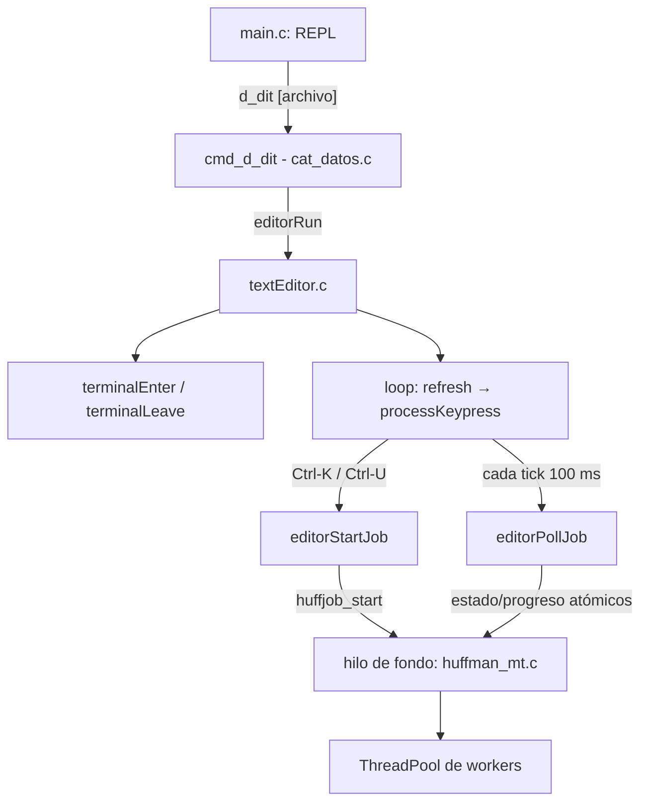

# Integración del editor (`dit`) con el shell

## Visión general



El shell solo conoce **una función**: `EditorStatus editorRun(const char *filename)`
(declarada en [textEditor.h](textEditor.h)). `cmd_d_dit` es un wrapper de unas
pocas líneas que traduce el resultado a un mensaje de error del shell.

## Contrato de `editorRun`

| Aspecto | Comportamiento |
|---|---|
| Precondición | stdin y stdout son un TTY; si no, retorna `EDITOR_ERR_TTY` sin tocar nada |
| Terminal | `terminalEnter()` activa modo raw + pantalla alterna; `terminalLeave()` lo restaura. Se llaman siempre en pareja dentro de `editorRun` (no hay `atexit` ni restauración dispersa) |
| Estado | Todo el estado vive en la global `E`, que se reinicia al entrar (`initEditor`) y se libera al salir (`editorFree`), así que abrir el editor varias veces no acumula filas ni nombres de archivo |
| Archivo | Si no existe, se abre un buffer vacío con ese nombre (se crea al guardar). Si no se puede leer, el editor abre igualmente y muestra el error en la barra de mensajes |
| Retorno | `EDITOR_OK`, `EDITOR_ERR_TTY`, `EDITOR_ERR_IO`. Ya no hay códigos mágicos (1/2/3/-1) ni logs de syscalls simulados |
| Salida | Si hay un job en curso, se cancela y se une (`join`) antes de liberar memoria |

## Qué se corrigió respecto a la integración original

- `die()` no terminaba nada: restauraba la terminal y devolvía `-1`, que los llamadores ignoraban. Se eliminó; los errores se propagan por valores de retorno.
- `enableRawMode` registraba `atexit(disableRawMode)` en cada invocación; ahora la restauración es simétrica y explícita.
- El estado global nunca se liberaba y `initEditor` pisaba punteros (fugas y datos de la sesión anterior).
- `getWindowSize` escribía en `E.*` en lugar de los punteros recibidos en su fallback.
- `editorReadKey` bloqueaba para siempre. Ahora `read()` expira a los 100 ms (`VMIN=0, VTIME=1`) y devuelve `KEY_NONE`; así el loop **refresca la pantalla sin tecla** y se puede mostrar el progreso en tiempo real. El tamaño de la ventana también se vuelve a leer en cada refresco.
- El `Makefile` ejecutaba el binario al compilar, `clean` usaba una variable inexistente y no enlazaba `pthread`.

## Loop principal

```c
for (;;) {
    editorRefreshScreen();                 // dibuja filas, barra de estado, barra de mensajes/progreso
    EditorAction a = editorProcessKeypress();   // lee tecla (o KEY_NONE tras 100 ms)
    if (a == EDITOR_QUIT)   break;
    if (a == EDITOR_FAILED) { status = EDITOR_ERR_IO; break; }
}
```

En cada `KEY_NONE` se llama `editorPollJob()`, que recoge el resultado de un job
terminado (mensaje de éxito/error/cancelación y recarga del buffer si procede).

## Teclas

| Tecla | Acción |
|---|---|
| Ctrl-S | Guardar |
| Ctrl-K | Comprimir el archivo actual a `<archivo>.huf` (prompt con destino por defecto) |
| Ctrl-U | Descomprimir el archivo actual (destino sugerido: sin `.huf`) |
| Ctrl-X | Cancelar la operación en segundo plano |
| Ctrl-Q | Salir (pide confirmación si hay cambios sin guardar o un job activo) |

## Trabajo en segundo plano y condiciones de carrera

El editor es un único hilo; el job corre en su propio hilo (y este en un pool
de workers, ver [HUFFMAN_THREADPOOL.md](HUFFMAN_THREADPOOL.md)). La
comunicación es por **estado atómico** (`state`, `phase`, `done/total`,
`cancel`), sin que la interfaz tome locks que puedan bloquearla.

Reglas que evitan inconsistencias:

1. **Un solo job a la vez** (`E.job`).
2. **Solo se opera sobre el archivo en disco**; si el buffer tiene cambios sin guardar, Ctrl-K/Ctrl-U se rechazan ("guarda primero"). Así lo que se comprime es exactamente lo que ve el usuario.
3. **Bloqueo del archivo**: mientras el job vive, cualquier ruta que sea su entrada o su salida (comparación por `dev/inode`, o por texto si no existe aún) está bloqueada. Con el buffer bloqueado, las teclas que lo modifican (texto, Enter, Backspace, Supr) y **Ctrl-S** (incluido "Save as" hacia esa ruta) se rechazan con un mensaje. Navegar, hacer scroll y cancelar siguen funcionando.
4. **Salida atómica**: el job escribe a un temporal (`mkstemp`) y hace `rename` solo si terminó bien; cancelado o con error se borra el temporal, nunca queda un archivo a medias.
5. **Recarga**: si el job produce el archivo que está abierto y el buffer no está modificado, se recarga automáticamente.
6. **Salida del editor** con job activo: requiere confirmar con Ctrl-Q; luego se cancela y se hace `join` antes de liberar.
